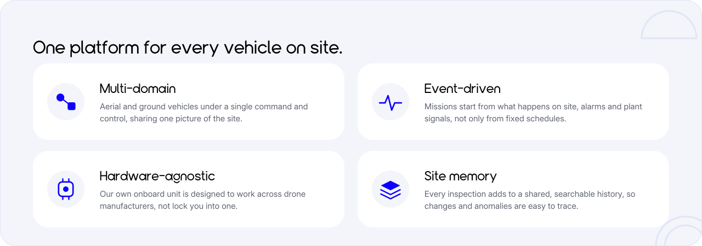

  <a href="https://soryon.com"><b>soryon.com</b></a>&nbsp;&nbsp;·&nbsp;&nbsp;<a href="mailto:hello@soryon.com"><b>hello@soryon.com</b></a>

 

**Soryon** is an Italian deep-tech startup founded in Genova in September 2026. We build the layer that makes drones, ground robots and the systems already running on a site work as one, starting from ports and complex industrial sites.

When something happens on site, Soryon turns it into a mission: the right vehicles go out, data comes back, and operators get an answer instead of another manual check.

 

  

 

© 2026 Soryon S.r.l. · Genova, Italy

